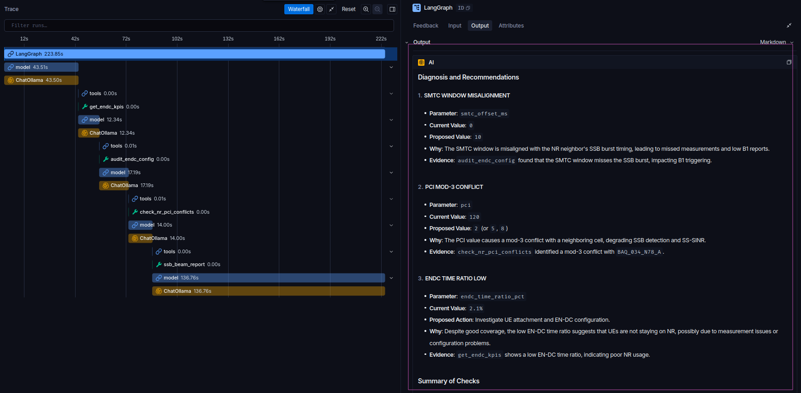
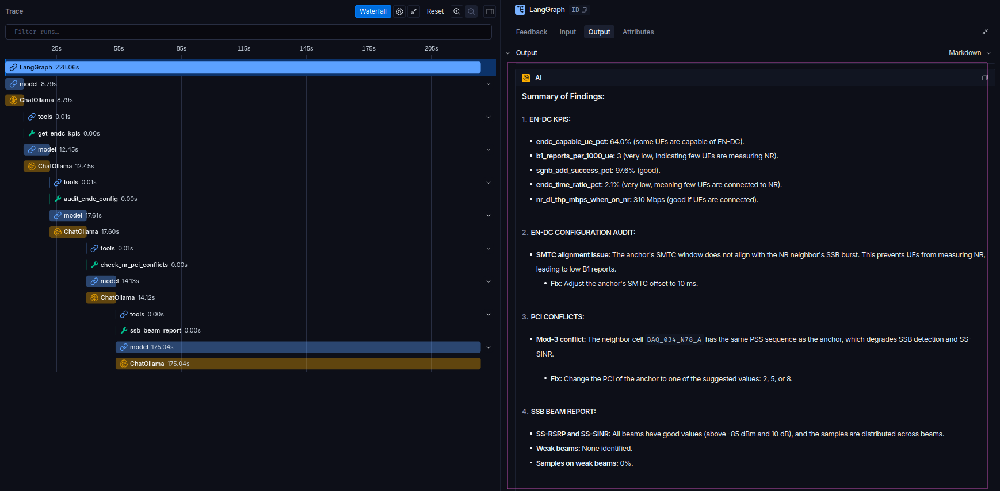

<div class="tldr">
<p class="tldr-title">En palabras simples</p>
<p>Las redes móviles tienen miles de configuraciones, y cuando los usuarios no reciben 5G, un ingeniero tiene que revisar datos de varios sistemas para encontrar la causa. Construí un <strong>asistente de IA que hace esa revisión</strong>: decide qué datos consultar, los lee con pequeños programas que escribí y explica la causa con evidencia. Cualquier cambio lo sigue aprobando una persona.</p>
<p>Lo interesante es lo que salió mal. Al principio el asistente se rendía antes de tiempo, me pedía que yo hiciera las revisiones o fingía hacerlas. <strong>Registrar cada paso que daba</strong> (sus "trazas") mostró exactamente dónde fallaba, y tras cuatro rondas de correcciones encontró todas las causas reales en los dos casos de prueba. Todo corre en un computador normal, sin IA en la nube y sin datos reales de ninguna red.</p>
<p><strong>Por qué importa más allá de la demo:</strong> el razonamiento del asistente no depende de que los datos sean ficticios. Pasar de la prueba de concepto a una red real consiste en apuntar esos mismos programas a exportes de solo lectura de la configuración y los KPIs de la red, y validarlo con casos pasados de causa conocida antes de confiar en él. El beneficio: un primer diagnóstico en minutos en lugar de un ingeniero cruzando varios sistemas a mano, el mismo checklist aplicado siempre y la evidencia adjunta a cada recomendación, para que los ingenieros dediquen su tiempo a decidir y no a buscar.</p>
</div>

Todo ingeniero RF que trabaja con 5G NSA ha recibido este ticket: *"el anchor tiene cobertura n78, los teléfonos soportan 5G, pero los usuarios casi nunca ven el ícono de 5G"*. Los drive tests muestran buen SS-RSRP, no hay alarmas, y aun así el EN-DC time ratio está en 2 %.

Si le preguntas a un modelo de lenguaje, te da una lista razonable: umbral B1, X2, vecinas NR, SMTC. Lo que no te da es **tu** offset de SMTC, **tu** timing de SSB en el gNB ni **tus** contadores de B1. El modelo nunca ha visto tu red, así que llena el vacío con texto que suena bien.

El tool calling cierra esa brecha. Le das al modelo funciones que puede llamar (*lee los KPIs EN-DC de este anchor*, *audita su configuración de medición NR contra el gNB*, *muéstrame el SS-RSRP por beam SSB*). El modelo decide **qué** función llamar y **con qué argumentos**; tu código devuelve datos reales; el modelo razona sobre ellos.

Trabajo en optimización RAN, así que armé un pequeño **agente de troubleshooting de 5G NSA** que corre **100 % local** en [Ollama](https://ollama.com). Empecé con **Gemma 4**, un modelo de pesos abiertos con function calling nativo, y terminé comparándolo con **Qwen3 8B**; las trazas decidieron. Construí el agente dos veces:

1. **Por dentro**: un loop sin dependencias, solo con la librería estándar de Python.
2. **Con LangChain**: el mismo agente con `create_agent`, que es lo que usaría en la práctica.

> Todos los datos de red de este post son **ficticios** y el modelo de propagación está simplificado. Es un laboratorio de aprendizaje, no una herramienta de producción.

## EN-DC en 30 segundos

En NSA opción 3x el UE se engancha a LTE. La celda LTE, llamada **anchor** o MeNB, le dice al UE dónde buscar NR: un `measObjectNR` con la **frecuencia del SSB** (NR-ARFCN), el subcarrier spacing del SSB y una **SMTC** (SSB-based measurement timing configuration). La SMTC es la ventana de tiempo en la que el UE escucha los SSB.

Cuando el SS-RSRP de n78 supera el **umbral B1**, el UE envía un reporte, el anchor pide una **SgNB addition** por X2 y el UE agrega NR como secondary cell group (SCG). Si después la cobertura NR se cae, aparece un **SCG failure**.

Cualquier eslabón de esa cadena puede romper EN-DC sin una sola alarma: frecuencia de SSB equivocada, una ventana SMTC que no coincide con el burst de SSB, un B1 demasiado estricto o demasiado permisivo, X2 caído, conflictos de PCI, beams SSB débiles.

## Setup: Ollama y un modelo que soporte tools

Gemma 4 trae function calling incorporado, incluso en sus variantes "edge" pequeñas. Descarga el modelo y, sobre todo, **verifica que Ollama exponga la capacidad `tools`**:

```bash
ollama pull gemma4:e2b
ollama show gemma4:e2b      # en "Capabilities" debe aparecer: tools
```

Este chequeo ahorra tiempo. Gemma 3, por ejemplo, responde `does not support tools (status code: 400)` apenas le pasas una lista de tools, y algunas versiones tempranas de Ollama tenían el parser de tools de Gemma 4 roto. Si las tool calls vuelven como texto plano, actualiza Ollama primero.

## Las herramientas

| Tool | Tipo | Qué hace |
|---|---|---|
| `nr_link_budget` | Física | Path loss 3GPP TR 38.901 UMa → SS-RSRP en n78 y margen contra B1 |
| `get_endc_kpis` | OSS simulado | Reportes B1, SgNB addition, SCG failures, EN-DC time ratio |
| `audit_endc_config` | OSS simulado + reglas | `measObjectNR` del anchor vs SSB real del gNB: NR-ARFCN, SCS, **SMTC vs timing del SSB**, B1, X2 |
| `check_nr_pci_conflicts` | OSS simulado + reglas | PCI NR: colisión, mod-3 (PSS), mod-30 (DMRS/SRS de uplink) |
| `ssb_beam_report` | DT / MR L3 simulados | SS-RSRP, SS-SINR y porcentaje de muestras por beam SSB (L_max = 8 en n78) |

**La tool de física calcula en lugar de recordar.** Los LLMs son malos con los logaritmos y peores recordando la distancia de breakpoint de 38.901. Una función lo hace bien siempre:

```python
def nr_link_budget(distance_m: float, bs_height_m: float = 25.0, freq_ghz: float = 3.5,
                   los: bool = False, tx_power_dbm: float = 53.0,
                   ssb_beam_gain_dbi: float = 18.0, bandwidth_mhz: int = 100,
                   indoor: bool = False, b1_threshold_dbm: float = -105.0) -> dict:
    """Estimate n78 SS-RSRP at a distance (3GPP TR 38.901 UMa) and whether it passes the B1 threshold.

    Args:
        distance_m: 2D distance from the gNB to the user in meters (10 to 5000).
        ...
    """
    pl = _uma_path_loss(distance_m, bs_height_m, 1.5, freq_ghz, los)
    epre = tx_power_dbm - 10 * math.log10(12 * n_rb)          # energía del SSB por resource element
    ss_rsrp = epre + ssb_beam_gain_dbi - pl - (20.0 if indoor else 0.0)
    return {"path_loss_db": round(pl, 1), "ss_rsrp_dbm": round(ss_rsrp, 1),
            "passes_b1": ss_rsrp >= b1_threshold_dbm, ...}
```

El docstring no es decoración. Se convierte en la descripción que lee el modelo, así que ahí van las unidades y los rangos válidos.

**La tool de auditoría convierte criterio de ingeniería en código.** Es el chequeo más importante de este caso. Los bursts de SSB se repiten cada `ssb_periodicity` a partir de cierto offset; el UE solo escucha durante `[smtc_offset, smtc_offset + duration)`. Si el burst cae fuera de esa ventana, el UE nunca mide NR:

```python
# Los bursts SSB ocurren en burst_offset + k * ssb_periodicity; ventana SMTC = [offset, offset + duration)
delta = (nr["ssb_burst_offset_ms"] - smtc["offset_ms"]) % nr["ssb_periodicity_ms"]
window_ok = delta < smtc["duration_ms"]
period_ok = smtc["periodicity_ms"] % nr["ssb_periodicity_ms"] == 0
if not (window_ok and period_ok):
    findings.append({"check": "smtc_alignment", "severity": "critical",
                     "impact": "SMTC window misses the SSB burst: UE cannot measure NR, B1 rarely triggers",
                     "fix": {"smtc_offset_ms": nr["ssb_burst_offset_ms"] % smtc["periodicity_ms"]}})
```

Una aclaración honesta sobre `ssb_beam_report`: los contadores PM estándar son por celda, no por beam SSB. El SS-RSRP por beam sale de un scanner en drive test que decodifica el índice del SSB, o de reportes de medición L3 configurados con resultados por SSB (`rsIndexResults`), recolectados vía MR/MDT o trazas del vendor. Lo que hay disponible depende del vendor y de las licencias, así que la tool devuelve un campo `source` y el agente debe tratarla como evidencia de otro tipo, más escasa que los KPIs.

La red simulada tiene dos anchors LTE y tres celdas n78, y cada anchor trae un problema sembrado a propósito.

## Parte 1: el loop, por dentro

Los frameworks esconden dos cosas: convertir una función de Python en un JSON schema, y el loop. Las dos caben en una pantalla (aquí recortadas; el repo tiene la versión completa).

El schema sale de los type hints y de la sección `Args:` del docstring:

```python
PY_TO_JSON = {float: "number", int: "integer", str: "string", bool: "boolean"}

def function_to_schema(fn) -> dict:
    doc = inspect.getdoc(fn) or ""
    description = doc.split("\n\n")[0].replace("\n", " ")
    arg_docs = dict(re.findall(r"^\s{0,8}(\w+): (.+)$", doc.split("Args:")[-1], re.M))
    props, required = {}, []
    for name, param in inspect.signature(fn).parameters.items():
        props[name] = {"type": PY_TO_JSON.get(hints[name], "string"),
                       "description": arg_docs.get(name, "")}
        if param.default is inspect.Parameter.empty:
            required.append(name)
    return {"type": "function", "function": {"name": fn.__name__, "description": description,
            "parameters": {"type": "object", "properties": props, "required": required}}}
```

El loop llama a `/api/chat` de Ollama, ejecuta las tools que pida el modelo y le devuelve los resultados:

```python
for _ in range(MAX_STEPS):
    msg = chat(messages, schemas)             # POST /api/chat con la lista de tools
    messages.append(msg)
    calls = msg.get("tool_calls") or []
    if not calls:                             # texto plano -> respuesta final
        return msg["content"]
    for call in calls:
        name, args = call["function"]["name"], call["function"]["arguments"]
        try:
            result = registry[name](**args)
        except Exception as exc:              # nombre o argumentos inválidos: avisarle al modelo
            result = {"error": f"{type(exc).__name__}: {exc}"}
        messages.append({"role": "tool", "tool_name": name, "content": json.dumps(result)})
```

Tres detalles importan en la práctica:

- **`MAX_STEPS`** es el breaker. Los modelos pequeños a veces llaman la misma tool una y otra vez.
- **Los errores vuelven como datos.** Si el modelo inventa un nombre de celda, la tool responde `Unknown NR cell X. Known: [...]` y el modelo puede corregirse en el siguiente paso.
- **Varias llamadas por turno.** El modelo puede pedir los KPIs y la auditoría al mismo tiempo.

El system prompt fija el orden del diagnóstico (*primero KPIs, luego configuración, luego RF*) y una regla dura: **nunca inventar valores de KPIs ni de parámetros**.

## Parte 2: el mismo agente con LangChain

```python
from langchain.agents import create_agent
from langchain.tools import tool
from langchain_ollama import ChatOllama

lc_tools = [tool(fn, parse_docstring=True) for fn in TOOLS]

agent = create_agent(
    model=ChatOllama(model=MODEL, base_url=OLLAMA_HOST, temperature=0,   # gemma4:e2b o qwen3:8b
                     reasoning=False),                                  # sin "thinking" oculto en CPU
    tools=lc_tools,
    system_prompt=SYSTEM_PROMPT,
)
agent.invoke({"messages": [{"role": "user", "content": "Anchor BAQ_034_A has 7.8% SCG failures. Diagnose."}]})
```

`parse_docstring=True` hace lo mismo que mi `function_to_schema`, y `create_agent` corre el loop como un grafo de nodos `model` y `tools`. Con `LANGSMITH_TRACING=true`, cada llamada al modelo y a las tools queda trazada en LangSmith, lo cual sirve mucho más que un `print` cuando el agente toma un camino equivocado.

Construirlo primero a mano es lo que hace legible el framework. Cuando una traza muestra un nodo `tools` devolviendo un error, sabes exactamente qué pasó, porque ese `except` lo escribiste tú.

## Prueba 1: "hay cobertura 5G, pero nadie engancha 5G"

*"Anchor BAQ_021_A: EN-DC time ratio is only 2 % although n78 coverage looks good in drive tests. Diagnose and propose actions."*

Estas son las salidas reales de las tools que recibe el agente.

**`get_endc_kpis("BAQ_021_A")`**
```json
{
  "endc_capable_ue_pct": 64.0,
  "b1_reports_per_1000_ue": 3,
  "sgnb_add_attempts": 41,
  "sgnb_add_success_pct": 97.6,
  "scg_failure_pct": 0.9,
  "endc_time_ratio_pct": 2.1
}
```

Las additions funcionan cuando ocurren (97.6 %), pero casi nunca ocurren: **3 reportes B1 por cada 1.000 UEs**. El problema está antes de la admisión: los UEs simplemente no reportan NR.

**`audit_endc_config("BAQ_021_A")`** (el único hallazgo, un poco recortado)
```json
{
  "check": "smtc_alignment",
  "nr_cell": "BAQ_021_N78_A",
  "severity": "critical",
  "anchor_smtc": {"periodicity_ms": 20, "offset_ms": 0, "duration_ms": 5},
  "gnb_ssb": {"periodicity_ms": 20, "burst_offset_ms": 10},
  "impact": "SMTC window misses the SSB burst: UE cannot measure NR",
  "fix": {"smtc_offset_ms": 10}
}
```

El UE escucha de 0 a 5 ms; el gNB transmite su burst de SSB a los 10 ms. **La cobertura está bien; el timing no.** `ssb_beam_report("BAQ_021_N78_A")`, con datos de un scanner en drive test, lo confirma: todos los beams están entre −95 y −83 dBm, con SS-SINR entre 8.8 y 16.1 dB.

Recomendación esperada: poner el offset de la SMTC del anchor en 10 ms y verificar que los reportes B1 y el EN-DC time ratio se recuperen en las siguientes 24 horas.

## Prueba 2: "engancha 5G y lo pierde"

*"Anchor BAQ_034_A has 7.8 % SCG failures. Diagnose."*

Los KPIs muestran lo contrario: 820 reportes B1 por cada 1.000 UEs, 5.400 intentos de addition, 38 % de tiempo en EN-DC, pero **7.8 % de SCG failures** y solo 145 Mbps en NR. Tres tools, tres causas que se suman:

- **`audit_endc_config`**: umbral B1 en **−124 dBm**, demasiado permisivo. NR se agrega donde no se puede sostener.
- **`ssb_beam_report("BAQ_034_N78_A")`**, con MR de L3 con resultados por SSB: los beams **6 y 7** están débiles (SS-RSRP de −112 y −115 dBm, SS-SINR por debajo de 0 dB) y concentran el **18 %** de las muestras.
- **`check_nr_pci_conflicts("BAQ_034_N78_A")`**: PCI 123 contra PCI 120 de la vecina, un **conflicto mod-3** (misma secuencia PSS). Reemplazos sugeridos: 2, 5, 8.

La tool de física explica por qué importa el valor de B1. A 500 m en NLOS, un UE en exteriores recibe −94.1 dBm; el mismo UE en interiores (20 dB de O2I) recibe **−114.1 dBm**. Eso sigue por encima de −124, así que el UE se agrega a NR, pero queda muy por debajo del rango de −110 a −105 dBm que se suele usar como punto de partida para B1, donde el SCG tiene una chance razonable de sobrevivir. Recomendación esperada, en orden: subir el B1, corregir el PCI y revisar la cobertura de los beams 6–7. Si un modelo de 2B parámetros llega a eso es tema de la siguiente sección.

## Lo que pasó en realidad: la observabilidad cierra el loop

Todo lo anterior es lo que devuelven las tools. La pregunta de fondo es qué **hace** con ellas un modelo de 2B parámetros. Corrí tres preguntas contra `gemma4:e2b` en el server de mi laboratorio: los dos casos anteriores y una pregunta abierta en español, como la haría un ingeniero de campo (*"Los usuarios del sitio BAQ_021 casi no ven el ícono 5G. ¿Qué revisarías primero?"*).

### Corrida 1: el primer prompt

| Caso | Tools llamadas | Causas encontradas | Qué salió mal |
|---|---|---|---|
| SMTC (BAQ_021_A) | 2 | 1 de 1 | Nada. Diagnóstico y corrección correctos (offset de SMTC → 10 ms) |
| SCG failures (BAQ_034_A) | 2 | 1 de 3 | **Se detuvo en el primer hallazgo**: no revisó PCI ni beams SSB. Además dijo que un B1 de −124 dBm era "too high" |
| Pregunta abierta (BAQ_021) | 1 | 0 | **Le pidió al usuario que ejecutara `audit_endc_config`** en lugar de llamarla |

La terminal solo muestra el texto final, y el texto final *suena* bien. La traza no: muestra exactamente una llamada a tool y luego un mensaje del modelo que le devuelve el trabajo al humano. No es un problema de datos; es un problema del loop.

### Corrección 1: hacer explícito el proceso

Los modelos pequeños no deducen un procedimiento de troubleshooting; hay que escribírselo. El system prompt se convirtió en un checklist: KPIs, luego auditoría de configuración, luego PCI y beams SSB de **cada** vecina NR; reportar todos los hallazgos; nunca pedirle al usuario que ejecute una tool. También quité una ambigüedad de la tool: el hallazgo del B1 ahora dice explícitamente `"too low (too permissive)"`, para que el modelo no lo invierta.

### Corrida 2: mejor, y dos fallas nuevas

| Caso | Tools llamadas | Causas encontradas | Qué salió mal |
|---|---|---|---|
| SMTC (BAQ_021_A) | 5 | 2 de 2 | Siguió el checklist completo, encontró la SMTC **y** el PCI mod-3 de NR, y usó los beams para descartar cobertura. Detalle menor: una llamada duplicada |
| SCG failures (BAQ_034_A) | 3 | ? | **Terminó sin ninguna respuesta.** La terminal mostró tres llamadas a tools y nada más |
| Pregunta abierta (BAQ_021) | 1 | 0 | Llamó la tool con el **ID del sitio** (`BAQ_021`), recibió un error y, en vez de reintentar, **escribió "(se ejecutaría la herramienta aquí)" y simuló todo el diagnóstico** con valores de relleno |

La tercera es la falla más peligrosa de un agente: la salida *parece* trabajo, con títulos, checklist y tabla de acciones, pero no se ejecutó nada. Sin traza solo lo notarías leyendo con cuidado. Con la traza es evidente: una llamada que devolvió error, y después prosa.

La segunda me enseñó algo sobre mi propio código. Mi script solo imprimía las tool calls y las respuestas finales no vacías, así que una **tool call mal formada** (`invalid_tool_calls`) o un **mensaje final vacío** desaparecían en silencio. El agente no se caía; simplemente dejaba de hablar.

### Corrección 2: errores que el modelo pueda usar, y nada de finales silenciosos

- **Las tools resuelven lo que pueden.** Un ID de sitio que corresponde a una sola celda (`BAQ_021` → `BAQ_021_A`) se resuelve dentro de la tool. Cuando no se puede resolver, el error dice qué hacer: *"Call the tool again with an exact anchor ID from: [...]"*. Devolver errores como datos solo sirve si el modelo puede actuar con ese error.
- **Dos reglas más en el prompt:** si una tool devuelve error, corregir los argumentos y volver a llamarla; nunca describir ni simular una tool call, sino hacerla.
- **El script ahora imprime lo que antes era invisible:** tool calls inválidas, mensajes finales vacíos y un resumen de una línea por corrida (`modelo | tool calls | segundos`).

### Corrida 3: el modelo se vuelve el cuello de botella

Con el loop corregido, `gemma4:e2b` seguía sin terminar. La nueva salida del script lo hizo explícito:

- SCG failures: una tool call y luego `!! model returned an empty final message (done_reason=stop, eval_count=1)`. El modelo generó un solo token de fin de turno y se detuvo.
- Pregunta abierta: escribió `call: get_endc_kpis{anchor_cell_id: "BAQ_021_A"}` **como texto**, esta vez con el ID correcto, pero en un formato que el parser de tools de Ollama no reconoció. Cero tools ejecutadas.

Así que corrí las mismas tres preguntas, con el mismo prompt y las mismas tools, en `qwen3:8b`:

| Caso | Modelo | Tools llamadas | Causas reales encontradas | Recomendaciones sin respaldo | Tiempo |
|---|---|---|---|---|---|
| SCG failures | gemma4:e2b | 1 | 0 de 3 (respuesta vacía) | — | 22 s |
| Pregunta abierta | gemma4:e2b | 0 (tool call escrita como texto) | 0 de 2 | — | 10 s |
| SMTC | qwen3:8b | 4 | **2 de 2** | 2 | 213 s (arranque en frío) |
| SCG failures | qwen3:8b | 4 | **3 de 3** | **0** | 188 s |
| Pregunta abierta | qwen3:8b | 4 | **2 de 2** | 4 | 270 s |

`qwen3:8b` siguió el checklist todas las veces y encontró todas las causas reales, incluidas las tres del caso de SCG failures, con la dirección correcta para el B1 y el PCI que sugería la tool. En CPU tarda de tres a cuatro minutos por diagnóstico; el modelo pequeño es rápido, pero no sostiene el loop.

También mostró una falla nueva: el **relleno**. En dos de las tres corridas agregó recomendaciones que ninguna tool respaldaba, como `tx_power_dbm = 53 dBm` y `ssb_beam_gain_dbi`. Esos son *supuestos de entrada de la tool de link budget*, no parámetros de la red. También propuso subir un B1 sano de −105 a −95 dBm "porque está demasiado bajo", con el razonamiento al revés. En un NOC, ese es el tipo de error peligroso: un cambio de parámetro dicho con seguridad y sin evidencia.

### Corrección 3: cada acción necesita evidencia

El prompt ahora exige que cada acción cite el hallazgo de la tool que la respalda, que los chequeos que pasaron se listen bajo "Checks OK" en lugar de convertirse en acciones, y deja claro que los argumentos y supuestos de las tools no son parámetros de red.

### Corrida 4: respuestas con evidencia, y lo que queda

Mismo modelo (`qwen3:8b`), prompt v4, los dos casos que tenían relleno:

| Caso | Tools llamadas | Causas reales encontradas | Cambios de parámetros sin respaldo | Tiempo |
|---|---|---|---|---|
| SMTC | 4 | 2 de 2 | **0** (antes 2) | 224 s |
| Pregunta abierta | 4 | 2 de 2 | **0** (antes 4) | 228 s |

Cada acción ahora lleva su evidencia (`Evidence: audit_endc_config`, `Evidence: check_nr_pci_conflicts`), los beams sanos aparecen en "Checks OK" y los supuestos del link budget desaparecieron.

Lo que queda es más sutil, y es justo lo que un prompt no atrapa:

- **Números mal citados.** El resumen dice que todos los beams están "por encima de −85 dBm y 10 dB". La tool devolvió −83 a −95 dBm y 8.8 a 16.1 dB.
- **La celda equivocada.** "Cambiar el PCI del anchor": el anchor es la celda LTE; el PCI 120 es de la celda NR `BAQ_021_N78_A`.
- **Una afirmación falsa sobre su propio proceso.** "Umbral B1: no revisado directamente", aunque `audit_endc_config` lo revisó y no encontró nada.

Ninguno cambia el diagnóstico, pero en una herramienta de operación los tres erosionan la confianza. Además son fáciles de probar automáticamente: comparar cada número de la respuesta con las salidas de las tools en la traza, verificar que cada parámetro recomendado pertenezca a la celda que nombra, y usar un LLM como juez para el resto. Eso es evaluación, y es el próximo post.

### Lo que dicen las trazas sobre la latencia



*Corrida 4, caso SMTC en LangSmith. Izquierda: el waterfall. Derecha: la respuesta final, con la evidencia de cada acción.*

El waterfall responde una pregunta que la terminal nunca podría: ¿en qué se van los 224 segundos?

| Paso | Caso SMTC (224 s) | Pregunta abierta (228 s) |
|---|---|---|
| Cada una de las 4 tool calls | 0.00–0.01 s | 0.00–0.01 s |
| Pasos del modelo que eligen la siguiente tool | 43 + 12 + 17 + 14 s | 9 + 12 + 18 + 14 s |
| **Redacción de la respuesta final** | **137 s (61 %)** | **175 s (77 %)** |



*Corrida 4, pregunta abierta. Las tools son instantáneas; el último paso del modelo domina.*

Las tools no cuestan nada. La mayor parte del tiempo es el modelo **escribiendo un reporte largo y formateado en una CPU**. Así que la siguiente optimización no está en las tools ni en el loop: está en un formato de respuesta más corto (o un límite de tokens), o en una GPU. Sin la traza, la suposición natural habría sido "el agente es lento porque llama cinco tools", y habría sido falsa.

### El patrón

Ninguna de estas correcciones salió de mirar la respuesta final. Todas salieron de ver **lo que el agente realmente hizo**: qué tools llamó, con qué argumentos, qué volvió y dónde terminó el loop. Ese es todo el argumento a favor de la observabilidad en agentes. Una respuesta equivocada de una sola llamada a un LLM es una mala respuesta; una trayectoria equivocada en un agente es invisible si no la trazas.

También por eso cada cambio se midió con las mismas tres preguntas, en lugar de "ahora se ve mejor". Tres preguntas no son una evaluación, pero son la semilla de una, y ese es el próximo post.

## Lecciones del laboratorio

- **Revisa la capacidad de tools antes de culpar a tu código.** `ollama show <modelo>` te ahorra una hora depurando un error 400.
- **Que los números los pongan las tools.** El modelo elige el siguiente paso y explica; el código calcula y lee datos.
- **Los docstrings son prompts.** Unidades, rangos y definiciones de KPIs en el docstring mejoran notablemente los argumentos que manda el modelo.
- **Devuelve errores que el modelo pueda usar.** Un `{"error": ...}` mantiene viva la corrida, pero un modelo pequeño solo se recupera si el error le dice exactamente cómo reintentar. Mejor aún, resuelve los casos obvios dentro de la tool.
- **Traza la trayectoria, no solo la respuesta.** Las peores fallas (delegar en el usuario, simular tool calls, terminar en silencio) se ven bien en el texto final y son evidentes en la traza.
- **Los modelos pequeños necesitan el procedimiento por escrito.** Un checklist en el system prompt llevó el caso SMTC de 2 tool calls y 1 hallazgo a 5 tool calls y 2 hallazgos.
- **Las correcciones de prompt tienen techo; el tamaño del modelo también es un parámetro.** Pasado cierto punto, `gemma4:e2b` no sostenía un loop de 4 tools en Ollama, y `qwen3:8b` sí. Mide antes de cambiar.
- **Exige evidencia para cada acción.** Un modelo capaz va a rellenar su respuesta con cambios plausibles. Cada recomendación debe citar el hallazgo de la tool que la respalda.
- **Mide la latencia por paso antes de optimizar.** Las tools tardaron milisegundos; entre el 61 % y el 77 % de cada corrida fue el modelo escribiendo su reporte final en CPU.
- **Lo que el prompt no corrige, la evaluación lo tiene que atrapar.** Los números mal citados y las celdas equivocadas sobreviven a un buen prompt. Compara las respuestas con las salidas de las tools de forma automática.
- **Codifica el chequeo experto, no solo los datos.** La regla de alineación de la SMTC son tres líneas de código que la mayoría de las respuestas genéricas de un LLM nunca aplicarían a tus números reales.
- **Humano en el loop para cualquier escritura.** Estas tools solo leen y recomiendan. Cambiar SMTC, B1 o PCI en una red viva necesita aprobación, logs de auditoría y rollback, y eso es un problema de diseño, no de prompt.

## Qué sigue

El paso obvio es reemplazar los datos simulados por contadores y exportes de configuración reales, junto con **evaluar** el agente: un dataset de anchors con causas raíz conocidas y medir con qué frecuencia las encuentra. Es justo lo que estoy estudiando ahora para el examen LangChain Certified Agent Engineer, así que el siguiente post será sobre evaluación de agentes con LangSmith.

El código completo (tools, los dos agentes y los tests offline) está en GitHub: [codeviloria/5g-nsa-agent](https://github.com/codeviloria/5g-nsa-agent). La carpeta `runs/` tiene el registro de cada iteración descrita aquí.

---

*Soy ingeniero de telecomunicaciones, trabajo en optimización RAN y estoy en transición hacia la ingeniería de IA. Escribo sobre agentes, LLMs locales y qué pasa cuando los pones frente a problemas reales de ingeniería.*
